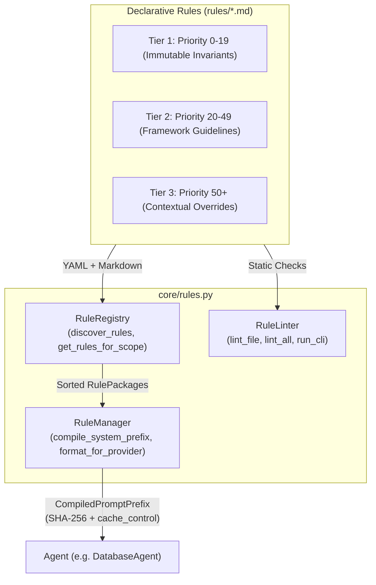

ll# Universal Application Rules Engine (`core/rules.py`)

This document provides the architecture, rule authoring specification, CLI usage, Python integration guide, and known limitations for the **Universal Application Rules Engine** (`core/rules.py`).

---

## 1. Overview & Architecture

The Rules Engine implements declarative rule discovery, three-tier precedence resolution, and deterministic KV-cache prompt prefix compilation (`RuleManager`) alongside a static validation CLI (`RuleLinter`).



### Core Components

| Component | Purpose | Key Guarantees |
|---|---|---|
| `RuleRegistry` | Thread-safe (`threading.RLock`) rule discovery and scope resolution across ordered `search_paths`. | Uses `os.walk(..., followlinks=False)` with `(st_dev, st_ino)` inode tracking to prevent symlink loops; caches parsed files by `mtime`; enforces Tier 1 immutability on matching scopes. |
| `RuleManager` | Compiles resolved rules into an immutable, byte-for-byte reproducible system prompt prefix (`CompiledPromptPrefix`). | Normalizes text (`normalize_content()`), guards against volatile tokens (`assert_no_volatile_tokens()`), memoizes compiled prefixes per `(agent_role, sorted_scopes, extra_static_blocks)`, and formats output for providers. |
| `RuleLinter` | Static analysis engine validating rule files and powering `python -m core.rules lint`. | Checks YAML frontmatter parsing, empty rule names, volatile tokens, and per-file token estimates (`LintReport` / `LintIssue`). |

### Three-Tier Precedence Hierarchy

Rules are organized into three tiers based on `priority` (lower numbers compile earlier in the prompt prefix):

1. **Tier 1 — Immutable Invariants (`priority` 0–19)**
   - Non-overridable operational and security boundaries.
   - `RuleMetadata.__post_init__` unconditionally sets `immutable = True` whenever `priority < 20`.
   - In `RuleRegistry.get_rules_for_scope()`, if a downstream rule shares the same `name` as an active Tier 1 rule (or attempts to override with a Tier 1 rule), `ImmutableRuleOverrideError` is raised.
2. **Tier 2 — Framework Guidelines (`priority` 20–49)**
   - Default domain and framework guidelines (e.g., SQL operational invariants).
   - Overridable by a rule with the same `name` in a higher-precedence `search_path` (an earlier directory in `RuleRegistry(search_paths=[...])`).
3. **Tier 3 — Contextual Overrides (`priority` 50+)**
   - Task- or project-specific policies. `priority` defaults to `50` when omitted or when a rule file has no YAML frontmatter.

### Deterministic Compilation & Byte Invariance

To preserve KV prompt-cache hit rates across turns and operating systems:

1. **Sorting**: `RuleRegistry.get_rules_for_scope()` sorts resolved rules strictly by the 3-tuple `(priority ASC, name ASC, resolved_file_path ASC)`.
2. **Compilation Order (Invariant-to-Variant)**: `RuleManager.compile_system_prefix()` assembles sections separated by `\n\n`:
   1. `agent_role` (if non-empty)
   2. Resolved rules in sorted order, each formatted as `### Rule: <name>\n<body_content>`
   3. `extra_static_blocks` (e.g., static database schema DDL or few-shot exemplars)
3. **Byte Normalization (`normalize_content`)**: Strips UTF-8 BOM (`\ufeff`), applies Unicode `NFKC` normalization, normalizes `\r\n` and `\r` line endings to `\n`, and strips leading/trailing whitespace.
4. **Digest & Estimate**: `CompiledPromptPrefix` computes `sha256_hash` over the UTF-8 encoded `system_prompt` and estimates tokens as `max(1, len(system_prompt) // 4)`.

---

## 2. Rule File Configuration (`rules/*.md`)

> [!WARNING]
> **Do NOT place non-rule `.md` files (such as `README.md` or design notes) inside `rules/` or any configured rule search directory.**
> `RuleRegistry.discover_rules()` and `RuleLinter.lint_all()` treat **every** `.md` file inside `rules/` as a rule file. Non-rule markdown files will be loaded as Tier 3 rules (defaulting to `priority: 50`, `scope: ["*"]`) or trigger linter diagnostics. Keep documentation in `docs/`.

### YAML Frontmatter Schema

Rule files are markdown documents parsed by `parse_rule_file()` using `yaml.safe_load`.

```markdown
---
name: sql_operational_invariants
description: Relational database safety boundaries and read-only invariants
scope:
  - database
  - sql
  - analytics
priority: 25
immutable: false
enabled: true
---

# Relational Database Invariants
1. **Read-Only Guarantees**: ONLY execute read-only queries (`SELECT` or `WITH ... SELECT`).
```

| Field | Type | Default | Behavior |
|---|---|---|---|
| `name` | `str` | Filename stem (`path.stem`) | Normalized via `.strip().lower().replace(" ", "_")`. Used for deduplication and override resolution across `search_paths`. |
| `description` | `str` | `""` | Human-readable summary of the rule's purpose. |
| `scope` | `list[str]` or `str` | `["*"]` | Target agent scopes (normalized to stripped lowercase strings). `"*"` matches all scopes; an empty list falls back to `["*"]`. |
| `priority` | `int` | `50` | Controls tier and prompt ordering (`0–19` Tier 1, `20–49` Tier 2, `50+` Tier 3). Values `< 20` force `immutable: true`. |
| `immutable` | `bool` | `False` | Prevents downstream overrides by `name`. Automatically forced `True` when `priority < 20`. |
| `enabled` | `bool` | `True` | When `False`, the rule is excluded during `get_rules_for_scope()`. |

If a `.md` file has no YAML frontmatter block (`--- ... ---`), `parse_rule_file()` derives `name` from the filename stem and defaults to `scope: ["*"]`, `priority: 50`, `immutable: False`, `enabled: True`.

### Static-Only Body Constraints (`assert_no_volatile_tokens`)

Both `RuleManager.compile_system_prefix()` and `RuleLinter.lint_file()` enforce static-only content via `assert_no_volatile_tokens()`, raising `VolatilePromptPrefixError` if dynamic tokens appear in `agent_role`, rule bodies, or `extra_static_blocks`:

- **ISO-8601 Datetimes**: Matches `\b\d{4}-(?:0[1-9]|1[0-2])-(?:0[1-9]|[12]\d|3[01])(?:T|\s)\d{2}:\d{2}` (e.g., `2026-11-24T10:30:00Z`).
- **UUIDs**: Matches `\b[0-9a-fA-F]{8}-[0-9a-fA-F]{4}-[0-9a-fA-F]{4}-[0-9a-fA-F]{4}-[0-9a-fA-F]{12}\b`.
- **Unrendered Template Placeholders**: Matches `{{...}}` and `${...}` (avoid including template placeholder examples inside rule bodies).
- **Allowed Strings**: Version numbers such as `3.11-slim` or `v1.2.3` are permitted.

---

## 3. Shipped Rules

The repository ships three baseline rule files under `projects/Agents/rules/`:

| File | `name` | Tier / `priority` | `scope` | `immutable` | Summary |
|---|---|---|---|---|---|
| `rules/00_global_invariants.md` | `global_invariants` | Tier 1 (`10`) | `["*"]` | `true` | Enforces bounded execution loop ceilings, strict output format discipline (no markdown fences when structured output is requested), and authorization checks before destructive operations. |
| `rules/10_security_guardrails.md` | `security_guardrails` | Tier 1 (`15`) | `["*"]` | `true` | Prohibits leaking environment variables, API keys, or auth tokens; enforces PII redaction/masking (passwords, SSNs); requires timeout and sandbox isolation for local code execution. |
| `rules/20_sql_invariants.md` | `sql_operational_invariants` | Tier 2 (`25`) | `["database", "sql", "analytics"]` | `false` | Enforces read-only queries (`SELECT` / `WITH ... SELECT`), schema verification against reflected database metadata, and explicit bounded row limits. |

---

## 4. CLI Usage (`python -m core.rules lint`)

Run the linter CLI from `/home/navin/work/AI/projects/Agents` using the workspace virtual environment (or with `.venv` activated):

```bash
# Lint the shipped rules directory (must pass `rules` explicitly)
/home/navin/work/AI/.venv/bin/python -m core.rules lint rules

# Treat warnings as errors (non-zero exit on warnings)
/home/navin/work/AI/.venv/bin/python -m core.rules lint rules --strict

# Display only ERROR diagnostics and the summary table
/home/navin/work/AI/.venv/bin/python -m core.rules lint rules --quiet

# Lint multiple specific files or directories
/home/navin/work/AI/.venv/bin/python -m core.rules lint rules/00_global_invariants.md rules/20_sql_invariants.md
```

> [!IMPORTANT]
> **Default-Path Caveat**: `run_cli()` in `core/rules.py` currently sets `default=["projects/Agents/rules"]` for the `paths` argument, while `python -m core.rules` must be run from `projects/Agents/` so the `core` package is on `sys.path`. Invoking `python -m core.rules lint` with no path argument from `projects/Agents/` attempts to scan `projects/Agents/projects/Agents/rules` and exits with code `1` (`Search path does not exist`). Always pass `rules` (or explicit target paths) when invoking from `projects/Agents/`. (Note: `RuleLinter.__init__` defaults to `[Path("rules")]` when used directly in Python.)

### Exit Codes & Diagnostic Levels

- **Exit `0`**: `report.has_errors` is `False` (and `report.warning_count == 0` when `--strict` is specified).
- **Exit `1`**: Missing/non-existent path, one or more `ERROR` diagnostics, `WARNING` diagnostics under `--strict`, or missing/unknown subcommand (`subcommand != "lint"`).

| Level | Conditions Reported by `RuleLinter` |
|---|---|
| `ERROR` | Path does not exist or is not a regular file; `RuleParseError` (malformed YAML frontmatter) or unreadable file; empty `name`; volatile datetime, UUID, or template placeholder in body. |
| `WARNING` | Explicitly targeted file lacks `.md` extension; empty markdown body. |
| `INFO` | Small rule body (`max(1, len(content) // 4) < 100` estimated tokens), noting it must be compounded with other rules/schema to meet provider cache thresholds (`>= 1,024` tokens). |

---

## 5. Python Configuration & Integration

### Basic Registry & Prompt Compilation

```python
from pathlib import Path
from core.rules import RuleRegistry, RuleManager

# Search paths ordered from highest precedence to lowest precedence
registry = RuleRegistry(
    search_paths=[
        Path("config/rules"),  # Optional project/env Tier 2 & Tier 3 overrides
        Path("rules"),         # Base framework Tier 1 & Tier 2 rules
    ]
)
manager = RuleManager(registry=registry)

compiled = manager.compile_system_prefix(
    agent_role="You are an expert Database and SQL Assistant.",
    scopes=["database", "sql"],
    extra_static_blocks=["### DATABASE SCHEMA:\nCREATE TABLE products (id INT, name TEXT);"],
)

print(compiled.active_rule_names)     # e.g. ['global_invariants', 'security_guardrails', 'sql_operational_invariants']
print(compiled.sha256_hash)           # Deterministic 64-char hex digest
print(compiled.cached_token_estimate) # Heuristic (~4 chars/token)
```

### Formatting for LLM Providers (`format_for_provider`)

```python
# OpenAI / Gemini / default: returns compiled.system_prompt (str)
openai_system = manager.format_for_provider(compiled, provider="openai")

# Anthropic / Claude: returns compiled.cache_control_blocks (List[Dict])
# [{"type": "text", "text": "...", "cache_control": {"type": "ephemeral"}}]
anthropic_system = manager.format_for_provider(compiled, provider="anthropic")
```

### Integrating with `DatabaseAgent`

`DatabaseAgent` (`core/db/agent.py`) accepts an optional `rule_manager: Optional[RuleManager] = None` parameter:

```python
from pathlib import Path
from core.db import DatabaseAgent, DatabaseEngine
from core.llm_clients import AnthropicClient
from core.rules import RuleManager, RuleRegistry

registry = RuleRegistry(search_paths=[Path("rules")])
rule_manager = RuleManager(registry=registry)

engine = DatabaseEngine("sqlite:///example.db")
llm = AnthropicClient()

agent = DatabaseAgent(
    engine=engine,
    llm_client=llm,
    rule_manager=rule_manager,
)
```

Inside `DatabaseAgent._build_system_prompt()`, when `rule_manager` is provided, it calls `self.rule_manager.compile_system_prefix(...)` with `scopes=["database", "sql"]`, an `agent_role` containing the database assistant persona and `self.engine.dialect.upper()`, and `extra_static_blocks=[f"### DATABASE SCHEMA & SAMPLE DATA:\n{self.schema.generated_ddl}"]`, storing `compiled.system_prompt` in `self._static_system_prompt`. When `rule_manager` is `None`, `DatabaseAgent` falls back to its built-in static SQL prompt string.

---

## 6. Known Limitations & Tracked Backlog Items

The following items are tracked in [specs/backlog.md](../specs/backlog.md) and documented in [docs/reviews/2026-11-25_rules_engine_critique_report.md](reviews/2026-11-25_rules_engine_critique_report.md):

- **P0 — Fail-Closed Discovery & Tier 1 Hardening (`core/rules.py`)**:
  - `RuleRegistry.discover_rules()` currently skips `(RuleParseError, OSError)` with `continue` rather than failing closed or logging.
  - `get_rules_for_scope()` filters by `enabled` and `scope` before checking `name` collisions, allowing a disjoint-scope rule to bypass a Tier 1 invariant or preventing `enabled: false` from disabling a Tier 2 default.
  - Duplicate `search_paths` entries overwrite precedence instead of keeping first-seen precedence, and same-directory Tier 2/3 name collisions do not tie-break by `priority`.
- **P1 — End-to-End `format_for_provider()` Wiring (`DatabaseAgent` & `BaseLLMClient`)**:
  - `DatabaseAgent._build_system_prompt()` currently returns `compiled.system_prompt` (`str`) without calling `format_for_provider()`.
  - `OpenAILLMClient`, `HuggingFaceClient`, and `MockLLMClient` need structured-block flattening if `List[Dict]` blocks are passed as `system`.
  - `compile_system_prefix()` does not yet emit a warning/log when the compiled prefix is below provider cache minimums (`< 1,024` tokens).
- **P1 — Cache Freshness, Immutability & Empty Blocks (`core/rules.py`)**:
  - `RuleManager._memoized_prefixes` does not automatically invalidate when existing rule files are edited on disk (`mtime` updates in `RuleRegistry`) or when new `.md` files are added to a directory without `force_reload=True`.
  - `format_for_provider(..., provider="anthropic")` returns `compiled.cache_control_blocks` directly without a deep copy, and empty inputs produce an empty `text` block.
- **P1 — Frontmatter, YAML Coercion, ReDoS & Linter Hardening (`core/rules.py`)**:
  - Frontmatter regex can treat leading markdown `---` horizontal rules as YAML frontmatter, YAML coercion allows `priority: false` $\to$ `0` and `enabled: "false"` $\to$ `True`, and `_VOLATILE_TEMPLATE_PATTERN` can backtrack quadratically on unclosed `{{`.
  - `RuleLinter.lint_all()` does not yet run cross-file `RuleRegistry` collision/budget checks; two branches in `lint_file()` (`not pkg.metadata.scope` and `priority < 20 and not pkg.metadata.immutable`) are unreachable because `RuleMetadata.__post_init__` normalizes them first; `run_cli()` default path (`projects/Agents/rules`) differs from `RuleLinter.__init__` (`rules`); and `core/__init__.py` imports `core.rules` symbols without listing them in `__all__`.
- **P1/P2 — Framework Rollout & Hash Drift Check**:
  - `SkillSubAgent` (`core/subagent.py`) and `run_agent.py` are not yet integrated with `RuleManager`, and `compiled.sha256_hash` persistence for crash-recovery drift detection is planned under Rule 8.
