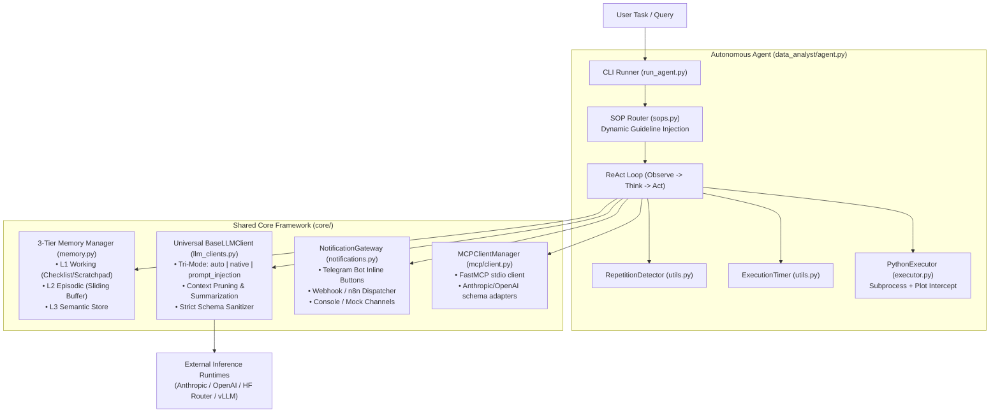

# Project Dossier: Multi-Agent AI Framework (`projects/Agents`)

## 1. Executive Summary & Purpose
- **Root Directory**: [`projects/Agents`](file:///home/navin/work/AI/projects/Agents)
- **Primary Domain**: Modular multi-agent and ReAct (Reasoning + Acting) execution framework. Serves as the foundational "Shared Core" for the workspace, providing unified LLM provider abstractions, 3-tier memory management, Model Context Protocol (FastMCP) adapters, remote notification routing, and autonomous agent loops (e.g. Data Analyst).
- **Core Technology Stack**: Python 3.12, Pydantic v2, FastMCP, Pandas, Matplotlib, OpenAI SDK, Anthropic SDK, Hugging Face Hub, Pytest.
- **Current Maturity / Phase**: **Production-Ready Shared Core (Phase 7.2 Complete)**. All 43 test suites passing across memory, LLM clients, notifications, and MCP adapters.

---

## 2. Documentation & Spec Inventory

| Document | Path | Purpose / Description |
| :--- | :--- | :--- |
| **Framework README** | [README.md](file:///home/navin/work/AI/projects/Agents/README.md) | High-level architecture, directory layout, quickstart, and agent execution guide |
| **Requirements Spec** | [requirements.md](file:///home/navin/work/AI/projects/Agents/requirements.md) | Initial technical specification for ReAct loop, Python executor, and checklist toggles |
| **Development Backlog** | [docs/backlog.md](file:///home/navin/work/AI/projects/Agents/docs/backlog.md) | Grouped architectural milestones (memory graphs, sandboxing, logit tweaking spike) |
| **Design Patterns Guide** | [docs/agentic_design_patterns.md](file:///home/navin/work/AI/projects/Agents/docs/agentic_design_patterns.md) | Detailed analysis of ReAct, Prompt-Chaining, Routing, and Multi-Agent Debate patterns |
| **Lessons Learned** | [docs/lessons_learned.md](file:///home/navin/work/AI/projects/Agents/docs/lessons_learned.md) | Post-mortem engineering insights, gotchas, and prompt optimization principles |
| **Skills Architecture** | [docs/skills_architecture.md](file:///home/navin/work/AI/projects/Agents/docs/skills_architecture.md) | SOP and declarative skill packaging design rules |

---

## 3. Core Architecture & Workflow

The framework operates on a **Shared Core Hub-and-Spoke Pattern**, where reusable foundation modules (`core/`) power independent, specialized agents (`data_analyst/`, `hitl_email_agent/`):



### Key Architectural Patterns
1. **Universal Provider-Native Tri-Mode Engine (`core/llm_clients.py`)**:
   - `auto`: Tries native grammar-constrained decoding (`response_format` on OpenAI/vLLM or forced tool use on Anthropic), gracefully falling back to prompt injection + JSON repair if endpoints reject native constraints.
   - `prepare_strict_json_schema()`: Recursively ensures `additionalProperties: False` and required property inclusion for OpenAI/vLLM compliance.
2. **3-Tier Memory Architecture (`core/memory.py`)**:
   - L1 Working Memory (mutable checklist and scratchpad).
   - L2 Episodic Buffer (sliding window with automated micro-summarization).
   - L3 Semantic Store (persistent entity registry with state export/import).
3. **Decoupled Notification Gateway (`core/notifications.py`)**:
   - Dispatches review payloads to Telegram (free interactive buttons), Webhooks (n8n/Zapier), and local consoles with environment variable pre-expansion and 64-byte safe UTF-8 callback hashing.
4. **Execution Safety & Subprocess Isolation (`data_analyst/executor.py`)**:
   - Deterministic execution in isolated subprocesses with timeout thresholds and automatic `matplotlib` chart saving to `outputs/`.

---

## 4. Key Source Code Files Matrix

| Component / Role | File Path | Key Classes / Functions | Primary Responsibility |
| :--- | :--- | :--- | :--- |
| **CLI Runner** | [run_agent.py](file:///home/navin/work/AI/projects/Agents/run_agent.py) | `main()` | CLI argument parsing, dataset loading, and agent execution invocation |
| **LLM Engine** | [core/llm_clients.py](file:///home/navin/work/AI/projects/Agents/core/llm_clients.py) | `BaseLLMClient`, `OpenAILLMClient`, `HuggingFaceClient`, `AnthropicClient`, `MockLLMClient`, `prepare_strict_json_schema` | Provider-agnostic API calling, context pruning, and tri-mode structured outputs |
| **Memory Engine** | [core/memory.py](file:///home/navin/work/AI/projects/Agents/core/memory.py) | `AgentMemoryManager`, `WorkingMemory`, `EpisodicBuffer`, `SemanticStore` | 3-tier memory management, state serialization, and task checklist tracking |
| **Notification Gateway** | [core/notifications.py](file:///home/navin/work/AI/projects/Agents/core/notifications.py) | `NotificationGateway`, `TelegramChannel`, `WebhookChannel`, `ConsoleChannel`, `MockChannel` | Asynchronous HITL review dispatch and interactive callback encoding |
| **MCP Client & Adapters** | [core/mcp/client.py](file:///home/navin/work/AI/projects/Agents/core/mcp/client.py), [adapters.py](file:///home/navin/work/AI/projects/Agents/core/mcp/adapters.py) | `MCPClientManager`, `MCPServerConnection`, `MCPToolAdapter` | Stdio FastMCP subprocess spawning, tool listing, and JSON schema conversion |
| **Agent Loop** | [data_analyst/agent.py](file:///home/navin/work/AI/projects/Agents/data_analyst/agent.py) | `DataAnalystAgent` | ReAct reasoning loop, hard loop limits (`max_loops=10`), tool dispatch |
| **Subprocess Executor** | [data_analyst/executor.py](file:///home/navin/work/AI/projects/Agents/data_analyst/executor.py) | `PythonExecutor` | Isolated code execution, output capture, and plot interception |
| **SOP Router** | [data_analyst/sops.py](file:///home/navin/work/AI/projects/Agents/data_analyst/sops.py) | `SOPRouter` | Dynamic intent-based SOP retrieval and prompt assembly |
| **Safety Utilities** | [core/utils.py](file:///home/navin/work/AI/projects/Agents/core/utils.py) | `RepetitionDetector`, `ExecutionTimer`, `StructuredOutputParser`, `JsonExtractor` | Infinite loop breaking, execution profiling, and JSON extraction |

---

## 5. Cross-Project & Shared Core References

- **Downstream Consumers**:
  - [`projects/hitl_email_agent`](file:///home/navin/work/AI/projects/hitl_email_agent): Imports `core/llm_clients.py` (via `src/hitl_agent/llm.py`), `core/notifications.py`, and `core/utils.py`.
- **Ecosystem Standard**:
  - Implements the foundational patterns cataloged in [`projects/agentic_blueprints`](file:///home/navin/work/AI/projects/agentic_blueprints) and tracks gaps mapped in [`docs/agentic_concepts_master_extraction.md`](file:///home/navin/work/AI/docs/agentic_concepts_master_extraction.md).

---

## 6. How to Run & Verify

### Quickstart Execution
```bash
# Run the Autonomous Data Analyst agent
python projects/Agents/run_agent.py \
  --agent data_analyst \
  --data projects/Agents/data_analyst/sample_data/sales.csv \
  --question "What are the top 3 products by total revenue?"
```

### Automated Test Suite Execution
```bash
# Run all 43 tests in the Agents test suite
PYTHONPATH=projects/Agents .venv/bin/pytest projects/Agents/tests/ -v
```

### Test Suite Inventory
- [tests/test_llm_clients.py](file:///home/navin/work/AI/projects/Agents/tests/test_llm_clients.py): 11 tests covering native structured decoding, strict schema normalization, auto-fallback, mock modes, and factory routing.
- [tests/test_agent_memory.py](file:///home/navin/work/AI/projects/Agents/tests/test_agent_memory.py): 5 tests validating L1, L2, L3 layers and state export/import.
- [tests/test_notifications.py](file:///home/navin/work/AI/projects/Agents/tests/test_notifications.py): 15 tests verifying Telegram, Webhook, Mock, environment variable expansion, and callback data hashing.
- [tests/test_mcp_client.py](file:///home/navin/work/AI/projects/Agents/tests/test_mcp_client.py) & [tests/test_mcp_adapters.py](file:///home/navin/work/AI/projects/Agents/tests/test_mcp_adapters.py): 9 tests verifying stdio FastMCP sessions and Anthropic/OpenAI schema adapters.
- [tests/test_parser.py](file:///home/navin/work/AI/projects/Agents/tests/test_parser.py): 3 tests verifying regex extraction and Pydantic validation.

---

## 7. Known Gotchas & Deferred Roadmap

1. **Active Considerations**:
   - **Environment Variables**: Requires `ANTHROPIC_API_KEY`, `OPENAI_API_KEY`, or `HF_TOKEN` (auto-detected from `~/.cache/huggingface/token` or local `hf_token` files).
   - **Mock Client Mode Default**: `MockLLMClient` defaults to `structured_output_mode="prompt_injection"` to ensure canned response sequences are preserved across offline test suites without unintended native token burns.
2. **Tracked Backlog Items**:
   - `[Logits Tweaking Spike]`: Implement a standalone PyTorch / HuggingFace `LogitsProcessor` prototype for FSM-guided logit masking ($-\infty$) and static token fast-forwarding (tracked in [docs/global_backlog.md](file:///home/navin/work/AI/docs/global_backlog.md)).
   - `[Semantic Memory Graph]`: Upgrade L3 semantic store to an embedded property graph (`Kùzu` or `NetworkX`).
   - `[Secure MicroVM Sandboxing]`: Transition `PythonExecutor` from local subprocesses to Firecracker microVM or Docker containers for untrusted code execution.
